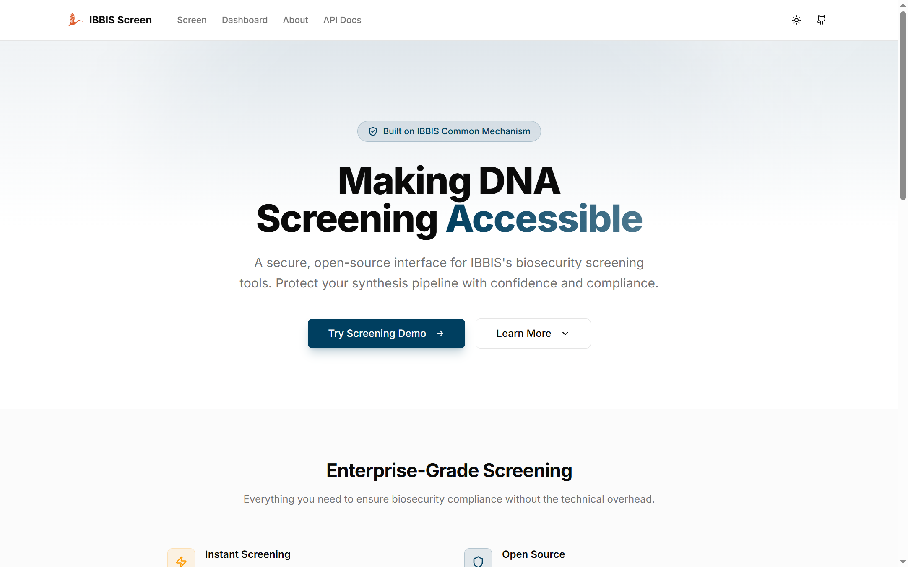
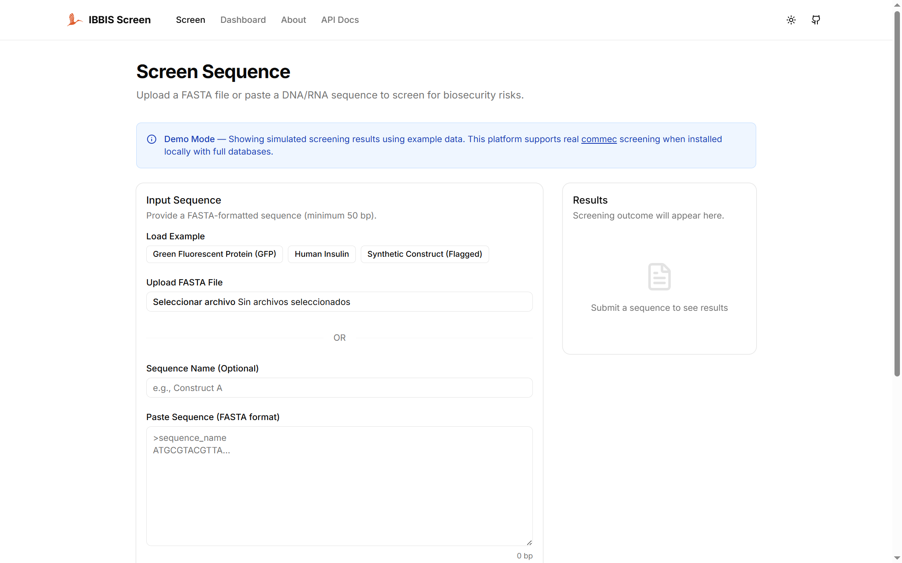
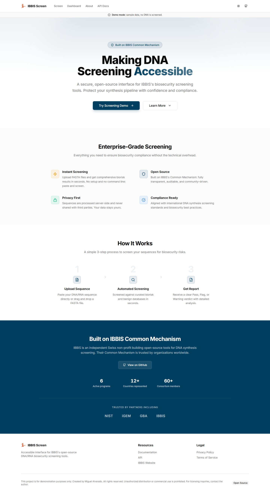
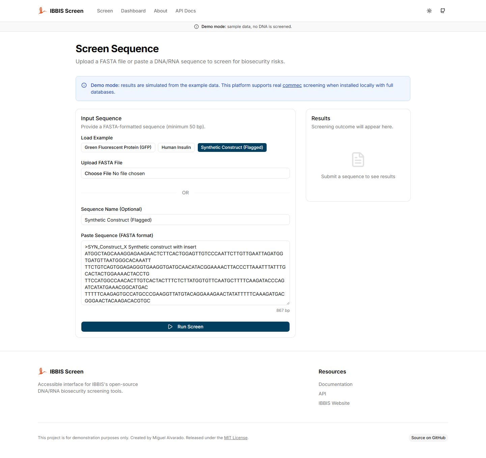
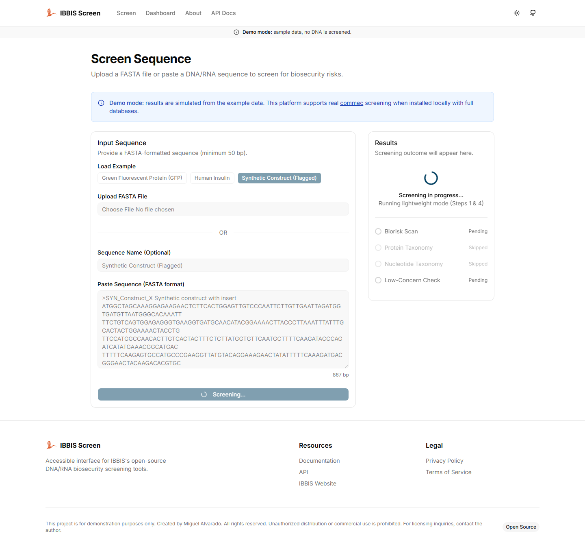
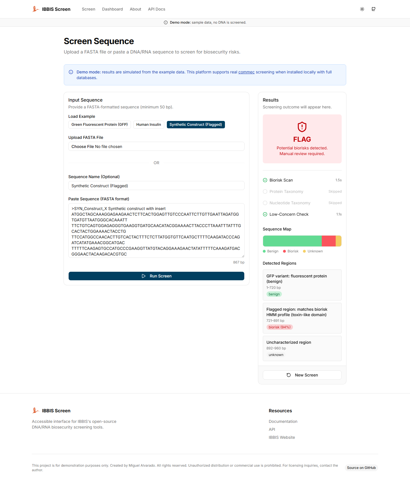

# IBBIS Screen

IBBIS Screen is a web interface for the [Common Mechanism](https://github.com/ibbis-bio/common-mechanism) (`commec`), the open-source DNA synthesis screening tool published by the [International Biosecurity and Biosafety Initiative for Science (IBBIS)](https://ibbis.bio/). `commec` runs from the command line and expects some bioinformatics background, which limits who can use it. This project wraps it in a browser workflow (paste or upload a FASTA sequence, follow the screening steps, read a Pass, Flag or Warning verdict with the regions that drove it) so that synthesis providers and lab technicians without command-line or bioinformatics expertise can run a screen.

**Live demo:** [ibbis.malvarado.org](https://ibbis.malvarado.org) (static demo mode: sample data, no DNA is screened)

**Status:** proof of concept, shared with the IBBIS team. Not intended for production screening.





## Demo walkthrough

Screenshots of the static demo build, taken at 1440 px:

| Landing | Input form |
|---|---|
|  |  |
| **Screening in progress** | **Results** |
|  |  |

## What it does

- Accepts a single FASTA sequence, pasted or uploaded, with a minimum length of 50 bp.
- Shows the four `commec` steps (Biorisk Scan, Protein Taxonomy, Nucleotide Taxonomy, Low-Concern Check) as the job runs.
- Reports an overall verdict (PASS, FLAG, WARNING) with a sequence map and the list of detected regions.
- Exposes a REST API (submit, poll, download a JSON or HTML report) for integration with other systems.
- Supports light and dark themes.

## Architecture

```
Browser ──► Frontend (Next.js 15) ──fetch──► Backend (FastAPI) ──subprocess──► commec (HMMER, BLAST, Infernal)
```

| Layer | Technology |
|---|---|
| Front end | Next.js 15, React 19, TypeScript, Tailwind CSS v4, shadcn/ui |
| Back end | Python, FastAPI, Pydantic v2 |
| Screening | `commec` 1.0.3, from the `quay.io/biocontainers/commec` image that the back-end image is built on |
| Packaging | Docker and Docker Compose |

- The back end accepts a job, runs `commec` as a subprocess and keeps results in memory for one hour. The front end polls the job every 1.5 seconds.
- By default the back-end image ships only the biorisk and low-concern databases (about 236 MB), so Steps 1 and 4 run and the two taxonomy steps are skipped (`--skip-tx`).
- If `commec` is not installed, the back end falls back to mock results, which is useful for front-end work without Docker.

### Real mode and demo mode

| | Real mode | Demo mode |
|---|---|---|
| Flag | `NEXT_PUBLIC_DEMO_MODE=false` | `NEXT_PUBLIC_DEMO_MODE=true` |
| Build output | Next.js `standalone` server (`.next/standalone`) | Fully static site (`frontend/out/`) |
| Back end | Required | Not used |
| Screening | `commec` runs on the submitted sequence | No sequence is screened; results come from `frontend/lib/mock-data.ts` |
| Progress | Reported by the back end | Simulated in the browser over about four seconds |
| Report download | Through the API (`/report` endpoint) | Not available |

In demo mode every API function in `frontend/lib/api.ts` returns before any network call and no API host is resolved, so the built site makes no requests outside its own origin. The three sample sequences (GFP, human insulin, and a synthetic construct with a flagged region) map to fixed results; any other input returns a generic PASS. A banner on every page states that the site is a demo.

## Run the real application with Docker Compose

Requirements: Docker with Docker Compose.

```bash
git clone https://github.com/malvarado-tech/ibbis-screen.git
cd ibbis-screen
docker compose up --build
```

The first build takes several minutes because it downloads the `commec` databases. Then open:

- Front end: http://localhost:3000
- Back-end health check: http://localhost:8000/api/v1/health

When the front end is opened from `localhost` it calls the back end at `http://localhost:8000`.

### Full taxonomy screening

Steps 2 and 3 need the NCBI databases, roughly 700 GB of disk:

```bash
docker compose up backend
docker exec -it ibbis-screen-backend-1 bash
commec setup -d /opt/commec/databases
```

| Database | Size | Used in |
|---|---|---|
| `biorisk` + `low_concern` | ~236 MB | Steps 1 and 4 (included by default) |
| `taxonomy` | ~2 GB | Steps 2 and 3 |
| `nr` (NCBI non-redundant protein) | ~350 GB | Step 2 |
| `core_nt` (NCBI core nucleotide) | ~250 GB | Step 3 |

Then set `IBBIS_SKIP_TAXONOMY=false` in the back-end environment in `docker-compose.yml` and restart.

### Back-end configuration

| Variable | Default | Description |
|---|---|---|
| `IBBIS_MOCK_MODE` | Auto-detected | `true` for mock results, `false` for real screening |
| `IBBIS_SKIP_TAXONOMY` | `true` | Skip Steps 2 and 3 |
| `IBBIS_COMMEC_THREADS` | `2` | CPU threads for `commec` |
| `IBBIS_COMMEC_TIMEOUT` | `300` | Maximum seconds per job |
| `IBBIS_COMMEC_DB_DIR` | `/opt/commec/databases` | Database directory |
| `IBBIS_COMMEC_CONFIG` | `/opt/commec/config.yaml` | `commec` YAML config, used if present |

### Local development without Docker

```bash
# Back end (falls back to mock results if commec is not installed)
cd backend
pip install -r requirements.txt
uvicorn main:app --reload --host 127.0.0.1 --port 8000

# Front end, in a second terminal
cd frontend
npm install
NEXT_PUBLIC_DEMO_MODE=false npm run dev
```

## Build the static demo

Requirements: Node.js 20 or later.

```bash
cd frontend
npm ci
NEXT_PUBLIC_DEMO_MODE=true npm run build   # writes the static site to frontend/out/
npx serve out                               # preview locally
```

On Windows PowerShell, set the variable first: `$env:NEXT_PUBLIC_DEMO_MODE="true"; npm run build`.

`next.config.ts` switches to `output: 'export'`, unoptimized images and trailing-slash URLs only when demo mode is on, so the Docker image keeps its `standalone` server build. The `out/` folder can be served by any static host.

To deploy on Vercel: root directory `frontend`, build command `npm run build`, output directory `out`, environment variable `NEXT_PUBLIC_DEMO_MODE=true`.

## API

| Method | Endpoint | Description |
|---|---|---|
| `POST` | `/api/v1/screen` | Submit a FASTA sequence |
| `GET` | `/api/v1/screen/{job_id}` | Poll job status and results |
| `GET` | `/api/v1/screen/{job_id}/report` | Download the report (JSON or HTML) |
| `GET` | `/api/v1/examples` | List example sequences |
| `GET` | `/api/v1/health` | Health check |

Request examples are on the API Docs page of the app.

## Known limitations

- One sequence per submission; multi-FASTA input is not supported.
- Lightweight screening by default (Steps 1 and 4) unless the NCBI databases are installed.
- Jobs are stored in memory and expire after one hour.

## Credits

Built by [Miguel Alvarado](https://github.com/malvarado-tech) on top of the [IBBIS Common Mechanism](https://github.com/ibbis-bio/common-mechanism). IBBIS Screen is an independent project, not an official IBBIS product.

## License

Copyright (c) 2026 Miguel Alvarado. See [LICENSE](LICENSE) for the terms. The Common Mechanism (`commec`) is distributed by IBBIS under its own license.
